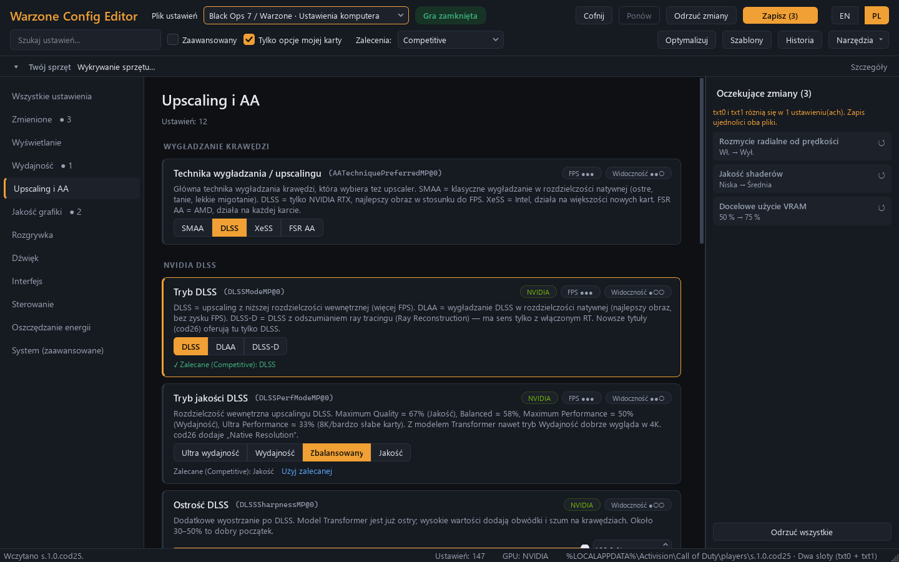
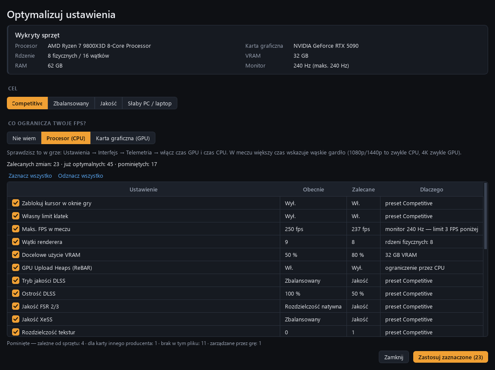
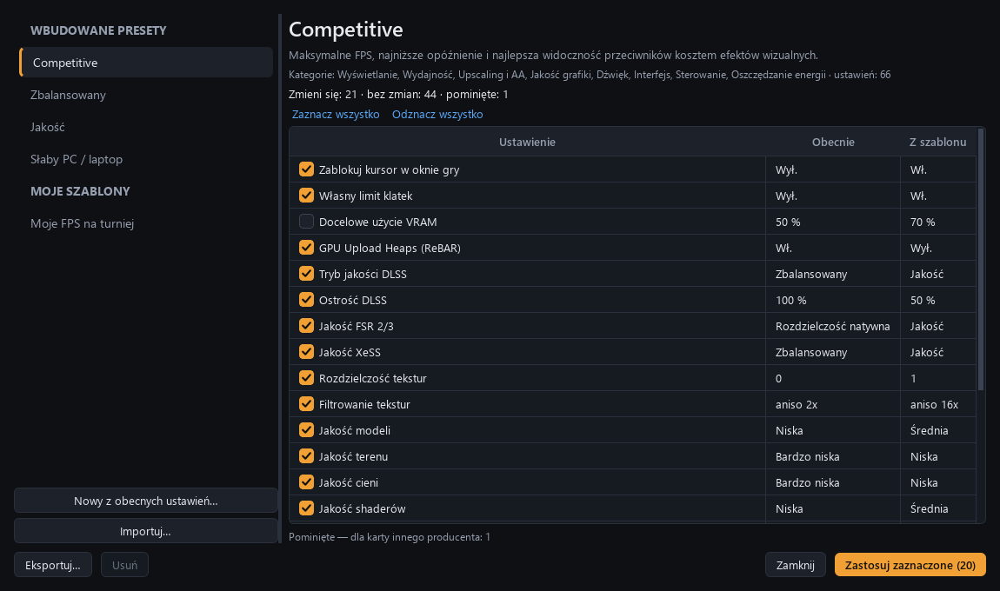
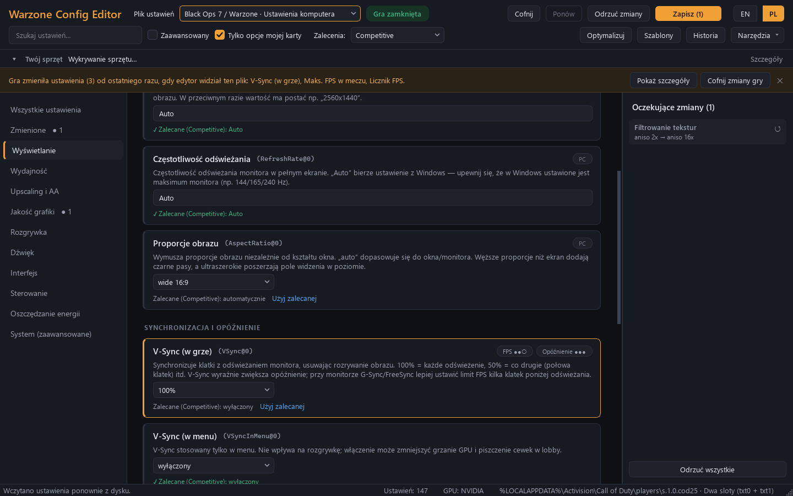
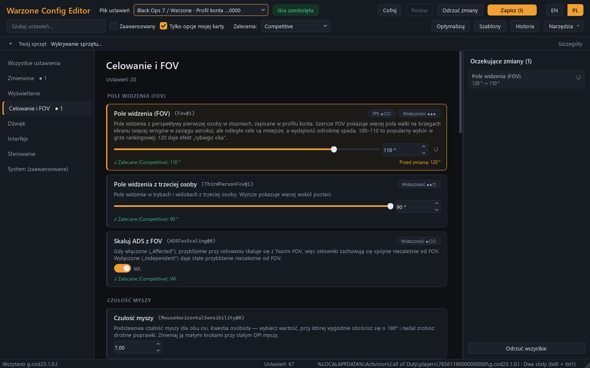
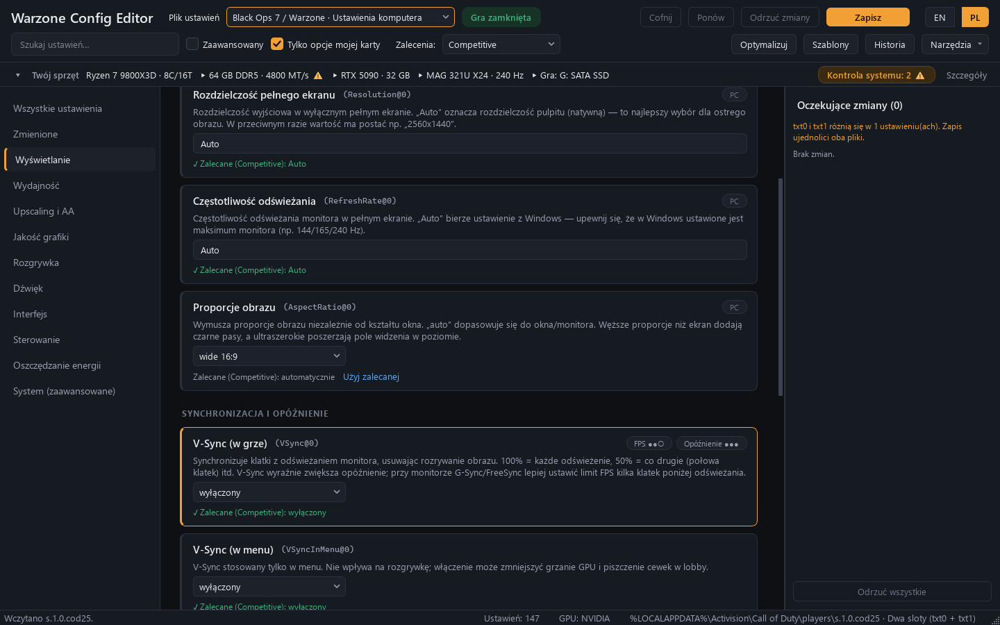
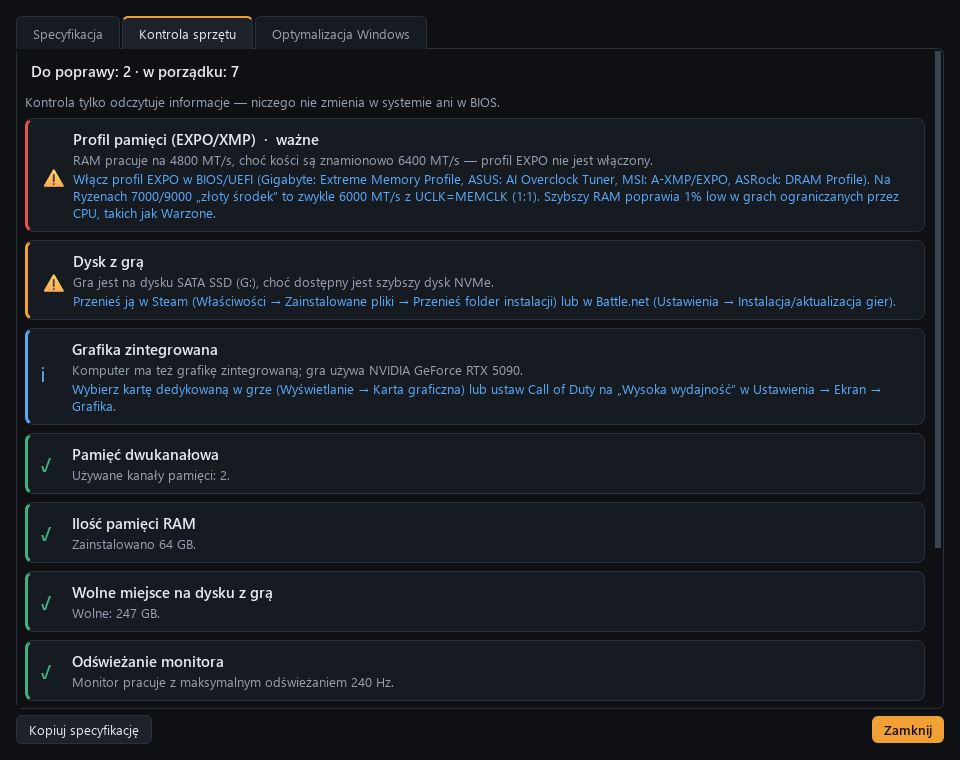
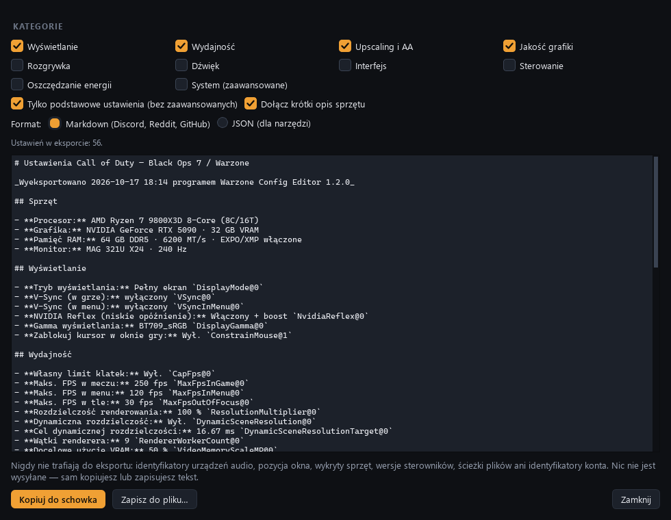
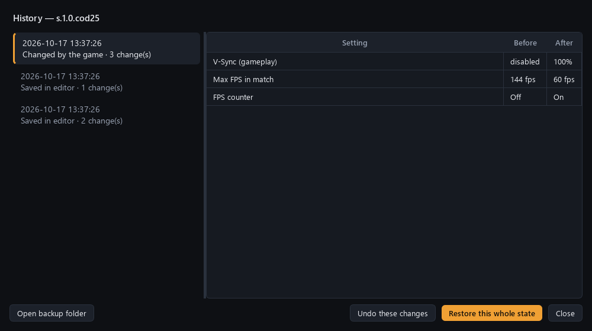
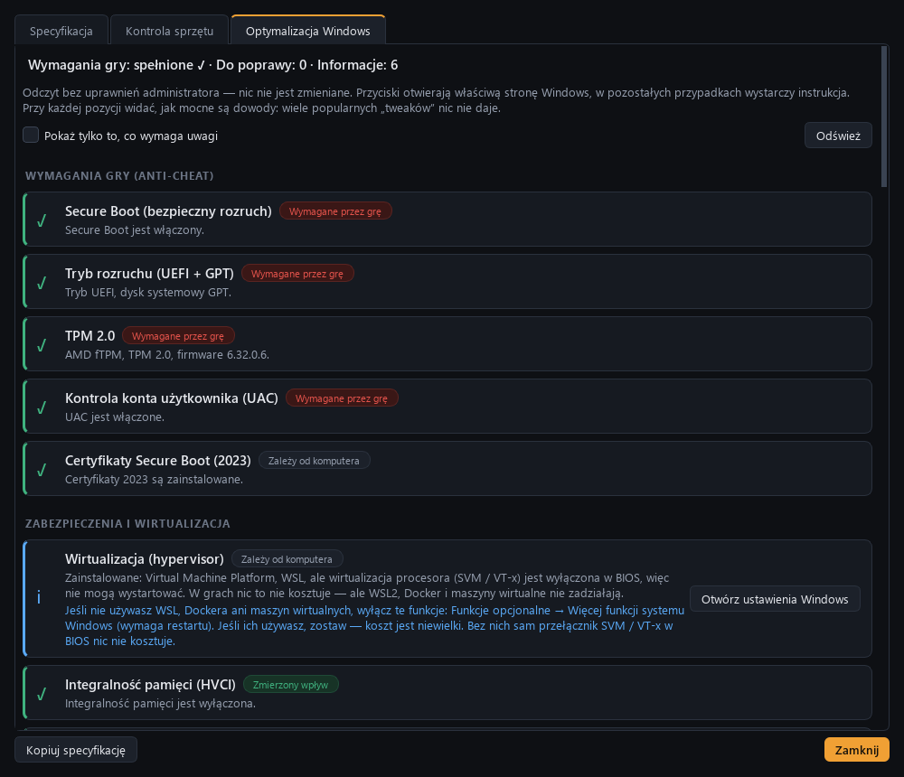

<p align="center"></p>

<h1 align="center">Warzone Config Editor</h1>

<p align="center">
Graficzny edytor plików ustawień <b>Call of Duty: Black Ops 7 / Warzone</b> (PC)<br>
Graphical editor for <b>Call of Duty: Black Ops 7 / Warzone</b> PC settings files
</p>

<p align="center"><a href="#polski">Polski</a> · <a href="#english">English</a></p>



---

<a id="polski"></a>
## Polski

### Co to jest?

Gra zapisuje ustawienia w plikach tekstowych w `%LOCALAPPDATA%\Activision\Call of Duty\players`.
Warzone Config Editor pokazuje je jako czytelne, opisane po polsku ustawienia z kontrolkami,
pilnuje poprawności wartości i bezpiecznie je zapisuje — z kopią zapasową i historią zmian.

### Funkcje

- **Wszystkie ustawienia z opisami PL/EN** — 230+ opcji z pliku komputera (grafika, wyświetlanie,
  upscaling, audio, system) i z pliku konta (czułość myszy, FOV, miks dźwięku, HDR), pogrupowane
  w kategorie, z oznaczeniem wpływu na FPS / opóźnienie / widoczność / VRAM.
- **Zalecenia** dla presetów Competitive, Zbalansowany, Jakość i Słaby PC — przy każdym ustawieniu,
  z wyjaśnieniem „dlaczego”.
- **Optymalizator** wykrywa procesor (także rdzenie P/E), kartę i VRAM, odświeżanie monitora
  i proponuje dopasowane wartości (wątki renderera, limit FPS, VRAM, upscaler, Reflex).
- **Szablony** — zapisz swoje ustawienia (całość albo wybrane kategorie), nałóż z podglądem zmian,
  eksportuj i importuj `.json`, utwórz szablon z cudzego pliku ustawień. Dane sprzętowe
  (karta, monitor, urządzenia audio) nigdy nie trafiają do szablonu.
- **Cofnij / Ponów** (Ctrl+Z / Ctrl+Y) i **trwała historia** każdego zapisu z możliwością przywrócenia.
- **Wykrywanie zmian zrobionych przez grę** — po aktualizacji lub zmianie w menu gry zobaczysz,
  co się zmieniło, i jednym kliknięciem przywrócisz swoje wartości.
- **Bezpieczny zapis**: blokada, gdy gra działa; kopia zapasowa przed każdym zapisem; oba pliki
  (`txt0` i `txt1`) zapisywane identycznie i atomowo; zachowany atrybut „tylko do odczytu”.
- **Narzędzia**: blokada plików przed nadpisaniem, „przywróć ustawienia zalecane przez grę”.
- **Twój sprzęt i kontrola systemu** — pasek ze specyfikacją komputera (CPU, RAM z prędkością
  i stanem EXPO/XMP, karta, monitor, dysk z grą) oraz 15 sprawdzeń z instrukcją naprawy:
  wyłączone EXPO/XMP, pamięć jednokanałowa, gra na HDD, monitor na niższym odświeżaniu, stary
  sterownik, złe złącze PCIe, wyłączony Resizable BAR, plan zasilania i inne.
  „Kopiuj specyfikację” przygotowuje tekst na Discord lub forum.
- **Optymalizacja Windows 11** (*Narzędzia* → *Optymalizacja Windows…*) — ok. 30 ustawień Windows
  ważnych dla gry, pogrupowanych w sekcje: wymagania anty-cheatu (Secure Boot, UEFI/GPT, TPM 2.0),
  wirtualizacja i zabezpieczenia, grafika (Auto HDR, MPO, karta dla gry), tryb gry i Xbox Game Bar,
  zasilanie (z regułami dla Ryzenów X3D i Intela 13./14. gen.), aktualizacje, plik stronicowania,
  nakładki w tle, mysz i sieć. Każda pozycja ma znaczek siły dowodów (wymagane / zmierzony wpływ /
  zależy od PC / bez wpływu na CoD), instrukcję i przycisk do właściwej strony Windows. Do tego
  lista mitów („tweaki”, które nic nie dają albo szkodzą) i lista kontrolna BIOS. Część ustawień
  (tryb gry, nagrywanie w tle, Auto HDR, karta dla gry, akceleracja myszy, plan zasilania)
  program zmieni sam po kliknięciu „Napraw” — bez uprawnień administratora i z możliwością
  przywrócenia.
- **Udostępnianie ustawień** — czytelne podsumowanie (Markdown na Discord/Reddit albo JSON)
  wybranych kategorii, opcjonalnie z krótkim opisem sprzętu; bez danych identyfikujących.
- Ciemny motyw, przełączanie **PL / EN** w locie.

| | |
|---|---|
|  |  |
|  |  |
|  |  |
|  |  |
|  | |

### Pobranie i uruchomienie

1. Pobierz `WarzoneConfigEditor-1.3.0.exe` (jeden plik, bez instalacji).
2. Uruchom. Przy pierwszym uruchomieniu Windows SmartScreen może pokazać ostrzeżenie
   („Nieznany wydawca”) — plik nie jest podpisany certyfikatem. Wybierz *Więcej informacji →
   Uruchom mimo to*. Sumę kontrolną SHA-256 znajdziesz w pliku `.sha256` obok.

Uruchomienie ze źródeł (wymaga [uv](https://docs.astral.sh/uv/)):

```
uv sync
uv run wzce
```

### Jak używać

1. **Zamknij grę** (wskaźnik w nagłówku pokazuje „Gra zamknięta”). Gra przy wyjściu nadpisuje
   pliki ustawień, więc edytor nie pozwoli zapisać, gdy działa.
2. Wybierz plik: **Ustawienia komputera** (grafika, wydajność) albo **Profil konta**
   (czułość, FOV, dźwięk). Edytor sam znajduje pliki BO7 (`cod25`), BO6 (`cod24`) i nowszych tytułów.
3. Zmieniaj ustawienia w kategoriach lub skorzystaj z **Optymalizuj** / **Szablony**.
   Panel po prawej pokazuje wszystkie zmiany „przed → po”.
4. **Zapisz** (Ctrl+S). Uruchom grę.

Wskazówka: jeśli gra cofa Twoje ustawienia po aktualizacjach, użyj
*Narzędzia → Zablokuj pliki (tylko do odczytu)*. Pamiętaj, że gra nie zapisze wtedy zmian
zrobionych w jej własnym menu.

### Bezpieczeństwo

- Edytor zmienia **wyłącznie tekstowe pliki ustawień**. Nie dotyka gry, jej procesu, plików
  binarnych, bindów ani folderu SteamCloud.
- Przed każdym zapisem tworzy kopię zapasową; każdą kopię i każdy zapis z historii można przywrócić.
- Edycja plików ustawień to zwykła zmiana konfiguracji (poradniki zalecają ją od lat) — narzędzie
  nie jest jednak oficjalnie wspierane przez Activision. Używasz na własną odpowiedzialność.

### Gdzie są dane programu

`%APPDATA%\WarzoneConfigEditor\` — `backups\` (kopie), `history\` (historia), `templates\`
(Twoje szablony), `settings.ini` (język, filtry, układ okna). Ścieżkę pokazuje też
*Narzędzia → O programie*.

### Najczęstsze pytania

- **Antywirus blokuje plik .exe** — programy w Pythonie spakowane PyInstallerem bywają fałszywie
  oznaczane. Możesz zbudować plik samodzielnie (sekcja niżej) albo uruchamiać ze źródeł.
- **„txt0 i txt1 różnią się”** — normalne: gra zapisuje dwie kopie na zmianę. Zapis w edytorze
  ujednolica obie.
- **Ustawienie oznaczone „Nowe”** — pojawiło się w aktualizacji gry i nie ma jeszcze opisu;
  edytor pokazuje opis z pliku gry i nadal pozwala je zmienić.
- **Wartość 119,900002 zamiast 119,9** — gra zapisuje liczby z małym zaokrągleniem; edytor to
  rozpoznaje i nie traktuje jako zmiany.

### Dla programistów

```
uv sync
uv run pytest                       # ~430 testów (rdzeń + GUI offscreen)
uv run ruff check . && uv run ruff format .
uv run wzce --report                # raport z wykrytych plików (tylko odczyt)
uv run wzce --system-report         # sonda sprzętu i ustawień Windows jako JSON (tylko odczyt)
uv run python scripts/build_exe.py  # budowa .exe + samotest (--onedir: wersja folderowa)
```

Dokumentacja: [architektura i rozwój](docs/ARCHITECTURE.md) · [plan](docs/PLAN.md) ·
[format plików](docs/FILE_FORMAT.md) · [baza wiedzy](docs/KNOWLEDGE_BASE.md) ·
[raport z researchu](docs/RAPORT.md) · [raport: sprzęt](docs/RAPORT_SPRZET.md) ·
[raport: Windows 11](docs/RAPORT_WINDOWS.md) ·
[zmiany](CHANGELOG.md). Wytyczne dla asystenta AI i twarde zasady zapisu: [CLAUDE.md](CLAUDE.md). Kod: Python 3.12 + PySide6; `src/wzce/core` (bez Qt) i `src/wzce/ui`.

---

<a id="english"></a>
## English

### What is it?

The game stores its settings in text files under `%LOCALAPPDATA%\Activision\Call of Duty\players`.
Warzone Config Editor turns them into readable, documented settings with proper controls,
validates every value and saves safely — with backups and a change history.

### Features

- **Every setting explained (EN/PL)** — 230+ options from the machine file (graphics, display,
  upscaling, audio, system) and the account file (mouse sensitivity, FOV, audio mix, HDR), grouped
  into categories and tagged with their impact on FPS / latency / visibility / VRAM.
- **Recommendations** for Competitive, Balanced, Quality and Low-end presets, with a "why".
- **Optimizer** detects your CPU (including P/E cores), GPU and VRAM, monitor refresh rate and
  suggests matching values (renderer threads, FPS cap, VRAM target, upscaler, Reflex).
- **Templates** — save your settings (all or selected categories), apply with a preview, export/import
  `.json`, or build a template from someone else's settings file. Hardware-specific values
  (GPU, monitor, audio devices) are never stored in templates.
- **Undo / Redo** (Ctrl+Z / Ctrl+Y) and a **persistent history** of every save, restorable.
- **Detects changes made by the game** (updates, in-game menu) and lets you put your values back.
- **Safe saving**: blocked while the game runs, backup before every save, both slots (`txt0`/`txt1`)
  written identically and atomically, read-only attribute preserved.
- **Tools**: lock files against being overwritten, "let the game reset to its recommendations".
- **Your hardware & system check** — a bar with your PC's spec (CPU, RAM speed and EXPO/XMP
  state, GPU, monitor, game drive) and 15 checks with fixes: EXPO/XMP off, single-channel RAM,
  game on HDD, monitor below its refresh rate, outdated driver, wrong PCIe slot, Resizable BAR off,
  power plan and more. "Copy specification" prepares text for Discord or forums.
- **Windows 11 optimization** (*Tools* → *Windows optimization…*) — about 30 Windows settings that
  matter for the game, grouped into sections: anti-cheat requirements (Secure Boot, UEFI/GPT,
  TPM 2.0), virtualization and security, graphics (Auto HDR, MPO, GPU for the game), Game Mode and
  Xbox Game Bar, power (with rules for Ryzen X3D and Intel 13th/14th gen), updates, page file,
  background overlays, mouse and network. Every row shows how strong the evidence is (required /
  measured effect / depends on the PC / no effect on CoD), a fix and a button to the right Windows
  page. Plus a list of myths (tweaks that do nothing or harm) and a BIOS checklist. Some settings
  (Game Mode, background recording, Auto HDR, GPU for the game, mouse acceleration, power plan)
  the app can change itself with "Fix" - no admin rights, always restorable.
- **Share settings** — a readable summary (Markdown for Discord/Reddit, or JSON) of the chosen
  categories, optionally with a short hardware summary; no identifying data.
- Dark theme, live **EN / PL** language switch.

### Download & run

Download `WarzoneConfigEditor-1.3.0.exe` (single file, no installation) and run it. Windows
SmartScreen may warn about an unknown publisher because the file is not code-signed — choose
*More info → Run anyway*. The SHA-256 checksum is in the `.sha256` file next to it.

From source (requires [uv](https://docs.astral.sh/uv/)): `uv sync` then `uv run wzce`.

### How to use

1. **Close the game** — it rewrites its settings on exit, so the editor refuses to save while it runs.
2. Pick a file: **Machine settings** (graphics, performance) or **Account profile**
   (sensitivity, FOV, audio). BO7 (`cod25`), BO6 (`cod24`) and newer titles are found automatically.
3. Edit settings by category or use **Optimize** / **Templates**; the right panel lists every
   pending change "before → after".
4. **Save** (Ctrl+S) and start the game.

### Safety

The editor only changes the **text settings files** — never the game, its process, binary files,
key bindings or the SteamCloud folder. Every save is preceded by a backup, and every backup and
history entry can be restored. Not affiliated with or endorsed by Activision; use at your own risk.

### Your data

`%APPDATA%\WarzoneConfigEditor\` — `backups\`, `history\`, `templates\` and `settings.ini`.

### Development

See the Polish section above for commands (`uv run pytest`, `uv run python scripts/build_exe.py`).
Start with [`docs/ARCHITECTURE.md`](docs/ARCHITECTURE.md) (module map, data flows, testing,
release checklist), then [`docs/FILE_FORMAT.md`](docs/FILE_FORMAT.md) and the rules in
[`CLAUDE.md`](CLAUDE.md). Code: Python 3.12 + PySide6, Qt-free core in
`src/wzce/core`, UI in `src/wzce/ui`.
